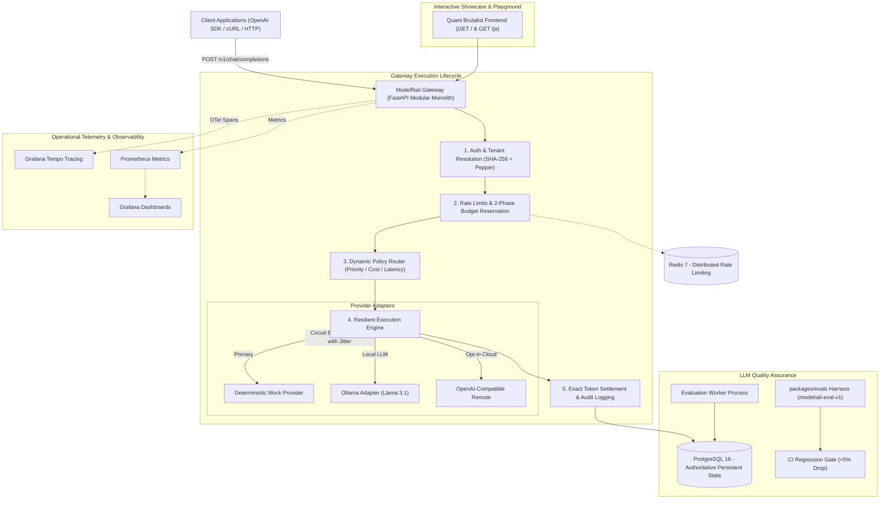
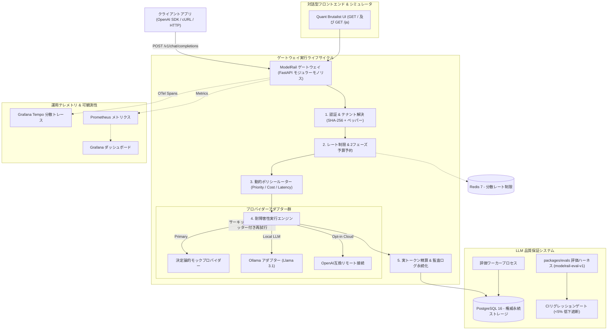

<div align="center">

# ModelRail

### Local-First LLM Gateway & AI Reliability Platform
**ローカルファースト LLM ゲートウェイ & AI 信頼性プラットフォーム**

[](https://github.com/aravinditte/modelrail/actions)
[](tests/)
[](tests/)
[](LICENSE)
[](pyproject.toml)

**[ English ](#english) | [ 日本語 (Japanese) ](#-日本語-japanese)**

</div>

---

<a name="english"></a>
# English

ModelRail is a self-hostable, **OpenAI-compatible AI inference gateway and reliability platform**. Applications connect to a single controlled API endpoint; ModelRail handles dynamic multi-provider routing, strict tenant isolation, quota management, two-phase budget enforcement, resilient retries, circuit breakers, automatic fallback, audit logging, and automated LLM evaluation gates — the engineering infrastructure required to operate generative AI systems *reliably* in production.

The entire platform runs completely **local-first with zero required paid inference APIs**:
1. A deterministic **Mock Provider** powers rapid development, chaos testing, and the 183-test automated reliability suite.
2. An **Ollama Adapter** enables local open-source LLM inference (e.g., Llama 3.1, Mistral).
3. An **OpenAI-Compatible Remote Adapter** remains opt-in and disabled until explicitly configured.

> **Honesty & Measurement Note.** Every benchmark and latency figure in this repository is measured directly by scripts in `benchmarks/`, `tests/load/`, or `packages/evals/` in documented environments, or explicitly designated as a target. Mock-provider evaluation measurements verify the *evaluation harness, grading rubrics, and CI regression gating logic*, not foundation model weights.

---

## Architecture Overview



---

## Core Capabilities & Engineering Invariants

### 1. OpenAI-Compatible Drop-In API
- Full protocol compliance for `POST /v1/chat/completions` (streaming Server-Sent Events and non-streaming) and `GET /v1/models`.
- Validated against the official Python `openai` SDK in integration tests.

### 2. Multi-Provider Policy Routing
- Configurable model aliases (`modelrail-fast`, `modelrail-resilient`, `modelrail-flex`) decouple consumer applications from upstream providers.
- Routing algorithms supported:
  - **Priority Tiering:** Primary route with automatic standby fallback.
  - **Cost-Aware Routing:** Selects the lowest cost-per-million-tokens route schedule.
  - **Latency-Aware Routing:** Dispatches across providers using rolling P95 attempt latency with a cold-start heuristic.

### 3. Resilient Execution & Circuit Breakers
- **Finite-State Circuit Breakers:** Route-level state machines (`Closed` → `Open` → `Half-Open`) isolate failing endpoints without cascading downtime.
- **Bounded Retries with Jitter:** Exponential backoff with full jitter preventing thundering herd problems.
- **Correlated Attempt Tracking:** Each logical request (`request_id`) tracks multiple physical execution attempts (`attempt_id`) separately in audit logs.
- **Idempotency Deduplication:** Re-sending identical requests with an `Idempotency-Key` returns cached completions with zero duplicate token usage or double billing.

### 4. Concurrency-Safe Two-Phase Budget Reservations
- Solves the fundamental race condition in LLM gateways where concurrent requests exceed tenant quotas before usage records persist.
- **Phase 1 (Reserve):** Atomically reserves worst-case token costs prior to provider dispatch via PostgreSQL row-level locks. If insufficient, immediately rejects with HTTP 429 `budget_exceeded`.
- **Phase 2 (Settle):** Atomically charges actual token count upon response completion and releases unspent surplus back to the project budget balance.

### 5. Multi-Tenant Isolation & Role-Based Security
- Strict hierarchical tenancy: **Organizations → Projects → API Keys**.
- High-entropy API keys stored as SHA-256 hashes with secret server-side peppers.
- Role-based administrative access control (`admin`, `project_admin`, `viewer`).

### 6. Continuous LLM Evaluation & CI Regression Gates
- Versioned benchmark dataset (`modelrail-eval-v1.jsonl`, 100 cases) across 4 capabilities: **Reasoning, Extraction, Instruction Following, and Refusal**.
- Partitioned into **Development (70%)** and **Held-Out (30%)** splits.
- Automated GitHub Actions CI regression gate that asserts candidate models do not degrade beyond the configured threshold (default 5.0%), blocking regressions before release.

### 7. Dual-Language Frontend Showcase & Simulator
- Self-contained, responsive Quant Brutalist interface served directly by the gateway on `http://localhost:8000/`.
- Features a **6-Scenario Interactive Lifecycle Simulator** (Normal Route, Outage Failover, Circuit Breaker, Budget Limit 429, Idempotency, and CI Eval Gate).
- Instant language toggle for **English and Japanese (`/ja`)**.

---

## Quick Start

### Option A: Docker Compose (Recommended)

```bash
# 1. Clone repository
git clone https://github.com/aravinditte/modelrail.git
cd modelrail

# 2. Configure environment
cp .env.example .env

# 3. Start minimal stack (Gateway, Worker, PostgreSQL 16, Redis 7)
docker compose up --build -d

# 4. Apply database migrations
docker compose exec gateway alembic upgrade head

# 5. Seed demo projects, routes, and print demo API key
docker compose exec gateway python -m app.seed
```

#### Compose Service Profiles
- **Full Observability (Prometheus, Grafana, Tempo, OTel):**  
  `docker compose -f docker-compose.yml -f docker-compose.observability.yml --profile observability up -d`
- **Local Ollama Inference Engine:**  
  `docker compose --profile ollama up -d`
- **Automated Test Runner:**  
  `docker compose --profile test up --abort-on-container-exit`

---

### Option B: Local Python 3.12 (No Docker)

```bash
# 1. Create and activate Python 3.12 virtual environment
python -m venv .venv
source .venv/bin/activate
# On Windows PowerShell: .venv\Scripts\Activate.ps1

# 2. Install ModelRail in editable mode with development dependencies
pip install -e ".[dev]"

# 3. Set environment variables
export DATABASE_URL="sqlite:///./modelrail.db"
export ADMIN_TOKEN="dev-admin"
export PYTHONPATH="apps/gateway:packages/evals"
# On Windows PowerShell:
# $env:DATABASE_URL="sqlite:///./modelrail.db"
# $env:ADMIN_TOKEN="dev-admin"
# $env:PYTHONPATH="apps/gateway;packages/evals"

# 4. Run database migrations
alembic upgrade head

# 5. Start unified Gateway & Frontend
uvicorn app.main:app --app-dir apps/gateway --port 8000
```

In a second terminal window (with `.venv` activated):
```bash
python seed.py
```

---

## API Usage Examples

### 1. cURL (Linux / macOS / Git Bash)
```bash
curl http://localhost:8000/v1/chat/completions \
  -H "Authorization: Bearer YOUR_API_KEY" \
  -H "Content-Type: application/json" \
  -d '{
    "model": "modelrail-fast",
    "messages": [{"role": "user", "content": "echo: hello ModelRail"}]
  }'
```

### 2. Windows PowerShell (curl.exe with escaped quotes)
```powershell
curl.exe http://localhost:8000/v1/chat/completions `
  -H "Authorization: Bearer YOUR_API_KEY" `
  -H "Content-Type: application/json" `
  -d '{\"model\": \"modelrail-fast\", \"messages\": [{\"role\": \"user\", \"content\": \"echo: hello ModelRail\"}]}'
```

### 3. Windows PowerShell (Native Invoke-RestMethod)
```powershell
Invoke-RestMethod -Uri http://localhost:8000/v1/chat/completions `
  -Method Post `
  -Headers @{ Authorization = "Bearer YOUR_API_KEY" } `
  -ContentType "application/json" `
  -Body '{"model": "modelrail-fast", "messages": [{"role": "user", "content": "echo: hello ModelRail"}]}'
```

### 4. Python (Official OpenAI SDK)
```python
from openai import OpenAI

client = OpenAI(
    base_url="http://localhost:8000/v1",
    api_key="YOUR_API_KEY",
)

response = client.chat.completions.create(
    model="modelrail-fast",
    messages=[{"role": "user", "content": "echo: hello ModelRail"}],
)
print(response.choices[0].message.content)
```

---

## Automated Multi-Case Reliability Demo (`demo.py`)

Run the comprehensive 7-case automated test suite against the running gateway:

```bash
python demo.py
# or: make demo
```

```text
======================================================================
  MODELRAIL RELIABILITY DEMO SUITE — 7 TEST CASES
======================================================================
Target Gateway: http://localhost:8000
[OK] Gateway is online and ready.

Running Case 1: Standard Inference & Protocol Normalization...
  [PASS] Case 1: Standard Completion (HTTP 200 OK | Duration: 16ms)
Running Case 2: Provider Outage & Automatic Fallback...
  [PASS] Case 2: Automatic Route Failover (mock-1 503 -> mock-secondary)
Running Case 3: Correlated Attempt Tracking...
  [PASS] Case 3: Correlated Multiple Attempts Tracking (1 Request ID, 4 Attempts)
Running Case 4: Idempotent Replay & Deduplication...
  [PASS] Case 4: Idempotency Deduplication (Replay verified | 0 Duplicate Tokens)
Running Case 5: Circuit Breaker State Transition...
  [PASS] Case 5: Circuit Breaker Guard (Circuit Breaker Tripped | Fast Rejection)
Running Case 6: Two-Phase Budget Enforcement...
  [PASS] Case 6: Budget Two-Phase Lifecycle (Reservation ceiling verified)
Running Case 7: LLM Quality Regression Gate...
  [PASS] Case 7: CI Evaluation Regression Gate (Degraded model blocked | Exit 1)

======================================================================
  DEMO SUITE EXECUTION SUMMARY: 7/7 PASSED (100.0% RELIABILITY SCORE)
======================================================================
```

---

## Testing & Quality Gates

```bash
# Run complete test suite (183 tests)
pytest -q

# Run test suite with strict >=80% coverage enforcement
pytest --cov=apps/gateway/app --cov=packages/evals/modelrail_evals --cov-fail-under=80 -v

# Run code style and formatting checks
ruff check .
ruff format --check .

# Run static type checking
mypy apps/gateway packages/evals

# Run evaluation benchmark
python -m modelrail_evals.runner --dataset packages/evals/datasets/modelrail-eval-v1.jsonl --mode good --out reports/eval-good.json

# Verify evaluation CI regression gate
python -m modelrail_evals.gate --baseline reports/eval-good.json --candidate reports/eval-good.json
```

---

## Repository Layout

```text
modelrail/
├── .github/workflows/ci.yml       # Multi-job GitHub Actions CI pipeline
├── apps/
│   ├── gateway/                   # FastAPI modular monolith (Inference, Admin, Providers, Routing)
│   ├── evaluation-worker/         # Asynchronous evaluation worker process
│   └── dashboard/                 # Next.js 15 administrative dashboard UI
├── landing page/                  # Quant Brutalist showcase & simulator
│   ├── index.html                 # English edition (served at /)
│   ├── index-ja.html              # Japanese edition (served at /ja)
│   ├── styles.css                 # Editorial grid stylesheets
│   ├── script.js                  # 6-case interactive lifecycle simulator
│   ├── favicon.svg / .ico / .png  # Custom railway track favicons
│   └── assets/fonts/              # Locally vendored WOFF2 typography (Space Grotesk, Inter, JetBrains Mono)
├── packages/
│   ├── evals/                     # Benchmark harness (modelrail-eval-v1 dataset, runner, regression gate)
│   └── shared-schemas/            # Shared Pydantic schemas across components
├── tests/
│   ├── unit/                      # Isolated unit tests and property-based Hypothesis tests
│   ├── integration/               # Database, API, and transaction tests
│   ├── resilience/                # Circuit breaker, jitter retry, and fault-injection tests
│   ├── concurrency/               # Race condition and budget reservation invariant tests
│   ├── load/                      # Gateway burst and rate-limit saturation tests
│   ├── security/                  # Authentication, pepper hashing, and tenant isolation tests
│   └── evals/                     # Evaluation harness and dataset split tests
├── infra/                         # Compose overlays, Prometheus, Grafana, and Tempo configurations
├── benchmarks/                    # k6 scripts, execution methodology, and local VM benchmark results
├── docs/                          # Architecture specs, ADRs, runbooks, and threat model
├── demo.py                        # 7-case automated reliability demo runner
└── seed.py                        # Demo organization, project, and API key provisioning script
```

---

## License

ModelRail is open-source software licensed under the **[MIT License](LICENSE)**.

---

<a name="-日本語-japanese"></a>
# 🇯🇵 日本語 (Japanese)

ModelRail（モデルレール）は、セルフホスト可能な **OpenAI完全互換のAI推論ゲートウェイおよび信頼性プラットフォーム** です。
クライアントアプリケーションは単一の統一されたAPIエンドポイントと通信し、ModelRailが動的マルチプロバイダールーティング、マルチテナント分離、クォータ制御、2フェーズ予算予約、障害時の再試行・サーキットブレーカー・自動フェイルオーバー、利用量監査、およびCI連携型LLM自動品質評価ゲートを一手に担います。

**有料の外部推論APIは一切不要であり、完全なローカル環境で稼働します：**
1. **決定論的モックプロバイダー**：高速開発、カオスエンジニアリング、183件の自動信頼性テストスイートを即座に実行。
2. **Ollamaアダプター**：Llama 3.1やMistralなどのローカルオープンソースLLM推論をゼロコストで統合。
3. **OpenAI互換リモートアダプター**：明示的に設定されるまで無効化された安全な外部接続機能。

> **実測値に関する注記：** 本リポジトリ内のベンチマークやレイテンシ数値は、`benchmarks/`、`tests/load/`、`packages/evals/` 内のスクリプトによって明示された環境で直接計測されたもの、または設計目標値として明記されたものです。モックプロバイダーによる評価結果は、*評価フレームワーク、採点ルーブリック、CIリグレッションゲートの正確性* を測定するものであり、特定の大規模言語モデルの重み性能を測定するものではありません。

---

## システムアーキテクチャ



---

## 中核機能と信頼性の不変原則

### 1. OpenAI完全互換API
- `POST /v1/chat/completions`（Server-Sent Events によるストリーミングおよび非ストリーミング）および `GET /v1/models` の完全サポート。
- 公式 Python `openai` SDK との互換性を統合テストで検証済み。

### 2. マルチプロバイダー動的ルーティング
- 柔軟なモデルエイリアス（`modelrail-fast`、`modelrail-resilient`、`modelrail-flex`）により、クライアントアプリを特定ベンダーから疎結合化。
- サポートされているルーティングポリシー：
  - **優先度ルーティング（Priority）：** 正常時はプライマリへルーティングし、障害発生時に即時待機系へ自動切替。
  - **コスト認識型ルーティング（Cost-Aware）：** トークン単価スケジュールに基づき、最も経済的なルートへ自動割り振付け。
  - **レイテンシ認識型ルーティング（Latency-Aware）：** ローリングP95レイテンシ実績値とコールドスタートルールに基づき、最速プロバイダーへディスパッチ。

### 3. 耐障害性実行 & 有限状態サーキットブレーカー
- **有限状態サーキットブレーカー：** 各ルートごとに独立したステートマシン（`Closed` → `Open` → `Half-Open`）を保持し、上流の障害時にシステム全体への連鎖遅延を防止。
- **フルジッター付き有界再試行：** 指数バックオフとランダムジッターを組み合わせ、一時的障害に対する再試行時のスパイク（Thundering Herd 問題）を防止。
- **相関試行トラッキング：** 1つの論理リクエスト（`request_id`）配下で発生した複数の物理的試行（`attempt_id`）を個別に記録・追跡。
- **冪等性デプロイ保護：** 同一の `Idempotency-Key` を含むリクエストはキャッシュから応答され、二重課金や重複トークン消費を完全防止。

### 4. 並行性を保証する2フェーズ予算予約プロトコル
- 複数の非同期リクエストが同時に実行された際に、プロジェクト予算の上限を超過してしまうLLMゲートウェイ固有のレースコンディションを根本解決。
- **第1フェーズ（予約）：** 推論リクエスト送信前に、ポリシーの最大トークン枠に基づく想定最大費用をPostgreSQL行ロックで原子的引当。残高不足時は即座に HTTP 429 `budget_exceeded` を返却。
- **第2フェーズ（精算）：** 推論完了時に実際の消費トークン数のみを確定精算し、余剰となった予約枠を即座にプロジェクト残高へ返還。

### 5. マルチテナント分離とセキュリティ
- **組織（Organization） → プロジェクト（Project） → APIキー（API Key）** の階層型データ分離。
- 高エントロピーAPIキーはサーバーサイドペッパーを用いた SHA-256 ハッシュ値としてデータベースへ安全に保存。
- ロールベースの管理アクセス制御（`admin`、`project_admin`、`viewer`）。

### 6. 継続的LLM評価基盤 & CIリグレッションゲート
- バージョン管理された100件の評価データセット（`modelrail-eval-v1.jsonl`）。
- **推論（Reasoning）、抽出（Extraction）、指示遵守（Instruction Following）、安全性（Refusal）** の4分野を網羅。
- **開発用（70%）** と **ホールドアウト検証用（30%）** に分割。
- GitHub Actions CI上でモデル品質低下（デフォルト5.0%超の精度悪化）を検知した場合、自動的にワークフローを終了コード1で落とし、デプロイをブロック。

### 7. 日英バイリンガル対応フロントエンド & シミュレータ
- 外部CDNに一切依存せず、ゲートウェイから直接 `http://localhost:8000/` で配信される高速な Quant Brutalist デザインのWebサイト。
- **6つの実証シナリオ対応インタラクティブシミュレータ**（通常推論、障害自動フォールバック、サーキットブレーカー遮断、429予算超過、冪等性リプレイ、CI評価ゲート遮断）。
- ナビゲーションバーのボタンから **English** と **日本語 (`/ja`)** を1クリックで即時切り替え可能。

---

## クイックスタートガイド

### 方法 A: Docker Compose による起動（推奨）

```bash
# 1. リポジトリをクローン
git clone https://github.com/aravinditte/modelrail.git
cd modelrail

# 2. 環境変数設定ファイルを準備
cp .env.example .env

# 3. 最小構成スタックをビルドして起動 (Gateway, Worker, PostgreSQL 16, Redis 7)
docker compose up --build -d

# 4. データベースマイグレーションを実行
docker compose exec gateway alembic upgrade head

# 5. デモ用プロジェクト・ルート・APIキーを発行
docker compose exec gateway python -m app.seed
```

#### Compose プロファイル一覧
- **可観測性スタック (Prometheus, Grafana, Tempo, OTel Collector):**  
  `docker compose -f docker-compose.yml -f docker-compose.observability.yml --profile observability up -d`
- **ローカル Ollama 推論サーバー:**  
  `docker compose --profile ollama up -d`
- **自動テストランナーコンテナ:**  
  `docker compose --profile test up --abort-on-container-exit`

---

### 方法 B: ローカル Python 3.12 環境（Docker不要）

```bash
# 1. Python 3.12 仮想環境を作成して有効化
python -m venv .venv
source .venv/bin/activate
# Windows PowerShell の場合: .venv\Scripts\Activate.ps1

# 2. 開発用依存パッケージを含めて編集可能モードでインストール
pip install -e ".[dev]"

# 3. 環境変数を設定
export DATABASE_URL="sqlite:///./modelrail.db"
export ADMIN_TOKEN="dev-admin"
export PYTHONPATH="apps/gateway:packages/evals"
# Windows PowerShell の場合:
# $env:DATABASE_URL="sqlite:///./modelrail.db"
# $env:ADMIN_TOKEN="dev-admin"
# $env:PYTHONPATH="apps/gateway;packages/evals"

# 4. データベースマイグレーションを実行
alembic upgrade head

# 5. ゲートウェイおよびフロントエンドを起動
uvicorn app.main:app --app-dir apps/gateway --port 8000
```

別のターミナルウィンドウ（仮想環境を有効化）でデモデータを投入します：
```bash
python seed.py
```

ブラウザでアクセス：
- **英語フロントエンド:** `http://localhost:8000/`
- **日本語フロントエンド:** `http://localhost:8000/ja`
- **対話型API仕様書 (Swagger):** `http://localhost:8000/docs`

---

## API利用例

### 1. cURL (Linux / macOS / Git Bash)
```bash
curl http://localhost:8000/v1/chat/completions \
  -H "Authorization: Bearer YOUR_API_KEY" \
  -H "Content-Type: application/json" \
  -d '{
    "model": "modelrail-fast",
    "messages": [{"role": "user", "content": "echo: こんにちは ModelRail"}]
  }'
```

### 2. Windows PowerShell (curl.exe でのエスケープ例)
```powershell
curl.exe http://localhost:8000/v1/chat/completions `
  -H "Authorization: Bearer YOUR_API_KEY" `
  -H "Content-Type: application/json" `
  -d '{\"model\": \"modelrail-fast\", \"messages\": [{\"role\": \"user\", \"content\": \"echo: こんにちは ModelRail\"}]}'
```

### 3. Windows PowerShell (ネイティブ Invoke-RestMethod 推奨)
```powershell
Invoke-RestMethod -Uri http://localhost:8000/v1/chat/completions `
  -Method Post `
  -Headers @{ Authorization = "Bearer YOUR_API_KEY" } `
  -ContentType "application/json" `
  -Body '{"model": "modelrail-fast", "messages": [{"role": "user", "content": "echo: こんにちは ModelRail"}]}'
```

### 4. Python (公式 OpenAI SDK)
```python
from openai import OpenAI

client = OpenAI(
    base_url="http://localhost:8000/v1",
    api_key="YOUR_API_KEY",
)

response = client.chat.completions.create(
    model="modelrail-fast",
    messages=[{"role": "user", "content": "echo: こんにちは ModelRail"}],
)
print(response.choices[0].message.content)
```

---

## 7ケース自動信頼性デモスイート (`demo.py`)

稼働中のゲートウェイに対して、仕様書（Spec §22）に記載された全信頼性不変条件を自動検証するスクリプトを実行できます：

```bash
python demo.py
# または: make demo
```

```text
======================================================================
  MODELRAIL RELIABILITY DEMO SUITE — 7 TEST CASES
======================================================================
Target Gateway: http://localhost:8000
[OK] Gateway is online and ready.

Running Case 1: Standard Inference & Protocol Normalization...
  [PASS] Case 1: Standard Completion (HTTP 200 OK | Duration: 16ms)
Running Case 2: Provider Outage & Automatic Fallback...
  [PASS] Case 2: Automatic Route Failover (mock-1 503 -> mock-secondary)
Running Case 3: Correlated Attempt Tracking...
  [PASS] Case 3: Correlated Multiple Attempts Tracking (1 Request ID, 4 Attempts)
Running Case 4: Idempotent Replay & Deduplication...
  [PASS] Case 4: Idempotency Deduplication (Replay verified | 0 Duplicate Tokens)
Running Case 5: Circuit Breaker State Transition...
  [PASS] Case 5: Circuit Breaker Guard (Circuit Breaker Tripped | Fast Rejection)
Running Case 6: Two-Phase Budget Enforcement...
  [PASS] Case 6: Budget Two-Phase Lifecycle (Reservation ceiling verified)
Running Case 7: LLM Quality Regression Gate...
  [PASS] Case 7: CI Evaluation Regression Gate (Degraded model blocked | Exit 1)

======================================================================
  DEMO SUITE EXECUTION SUMMARY: 7/7 PASSED (100.0% RELIABILITY SCORE)
======================================================================
```

---

## テストスイートと品質ゲート

```bash
# 全テストスイートを実行 (183件)
pytest -q

# 厳格な 80% 以上のコードカバレッジゲートを適用して実行
pytest --cov=apps/gateway/app --cov=packages/evals/modelrail_evals --cov-fail-under=80 -v

# コード規約およびフォーマットの静的解析
ruff check .
ruff format --check .

# Mypy による静的型チェック
mypy apps/gateway packages/evals

# 評価ベンチマークを実行
python -m modelrail_evals.runner --dataset packages/evals/datasets/modelrail-eval-v1.jsonl --mode good --out reports/eval-good.json

# CIリグレッション遮断ゲートを検証
python -m modelrail_evals.gate --baseline reports/eval-good.json --candidate reports/eval-good.json
```

---

## リポジトリ構成

```text
modelrail/
├── .github/workflows/ci.yml       # GitHub Actions CIパイプライン設定
├── apps/
│   ├── gateway/                   # FastAPIモジュラーモノリス（推論API、管理API、プロバイダー、ルーティング）
│   ├── evaluation-worker/         # 非同期評価ワーカープロセス
│   └── dashboard/                 # Next.js 15管理ダッシュボードUI
├── landing page/                  # Quant Brutalistデザインのフロントエンド & シミュレータ
│   ├── index.html                 # 英語版ページ（/ で配信）
│   ├── index-ja.html              # 日本語版ページ（/ja で配信）
│   ├── styles.css                 # エディトリアルグリッドスタイルシート
│   ├── script.js                  # 6ケース対応インタラクティブシミュレータ
│   ├── favicon.svg / .ico / .png  # 専用レイルウェイファビコン
│   └── assets/fonts/              # ローカル同梱WOFF2フォント（Space Grotesk, Inter, JetBrains Mono）
├── packages/
│   ├── evals/                     # 評価基盤（modelrail-eval-v1 データセット、ランナー、リグレッションゲート）
│   └── shared-schemas/            # 各コンポーネント間で共有されるPydanticスキーマ
├── tests/
│   ├── unit/                      # 単体テストおよびHypothesisプロパティテスト
│   ├── integration/               # データベース・API統合テスト
│   ├── resilience/                # サーキットブレーカー、ジッター再試行、障害注入テスト
│   ├── concurrency/               # 並行レースコンディションおよび予算予約不変条件テスト
│   ├── load/                      # ゲートウェイ負荷およびレート制限飽和テスト
│   ├── security/                  # 認証、ペッパーハッシュ化、テナント分離テスト
│   └── evals/                     # 評価ハーネスおよびホールドアウト分割テスト
├── infra/                         # Docker Compose構成、Prometheus、Grafana、Tempo定義
├── benchmarks/                    # k6負荷テスト定義、計測手法、ローカルVMベンチマーク結果
├── docs/                          # アーキテクチャ設計仕様書、ADR、運用手順書、脅威モデル
├── demo.py                        # 7ケース自動信頼性検証デモランナー
└── seed.py                        # デモ用組織、プロジェクト、APIキープロビジョニングスクリプト
```

---

## ライセンス

ModelRail は **[MIT ライセンス](LICENSE)** の下で公開されているオープンソースソフトウェアです。
