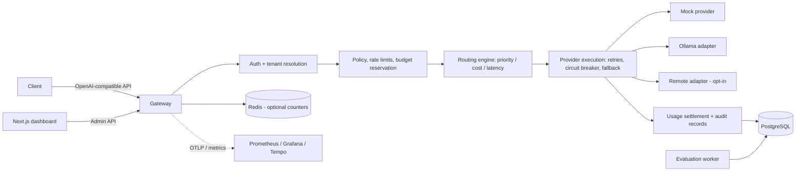

# ModelRail — Local-First LLM Gateway and AI Reliability Platform

ModelRail is a self-hostable, **OpenAI-compatible AI inference gateway**. Applications talk to
one controlled API; ModelRail handles provider routing, tenant isolation, quotas, budgets,
retries, circuit breakers, fallback, usage accounting, observability, and automated LLM
evaluation — the engineering required to run AI systems *reliably* in production.

The whole platform runs locally with **no paid inference API**: a deterministic mock provider
powers development, demos and the full reliability test-suite; Ollama adds optional local
inference; an OpenAI-compatible remote adapter stays disabled until you configure it.

> **Honesty note.** Every performance or quality figure in this repository is either measured
> by a script in `benchmarks/` / `packages/evals/` in a documented environment, or explicitly
> marked as a target. Mock-provider evaluation results measure the *evaluation framework and
> the scripted model*, not a real LLM.

## Features

- **OpenAI-compatible API** — `POST /v1/chat/completions` (streaming SSE + non-streaming),
  `GET /v1/models`; the official OpenAI SDK works against it (covered by a test).
- **Providers behind one contract** — deterministic mock (with failure injection), Ollama,
  and an optional remote OpenAI-compatible adapter with an SSRF guard.
- **Routing policies** — priority, cost-aware (Decimal price schedules), latency-aware
  (rolling attempt latency with a cold-start rule). Every decision is recorded for audit.
- **Reliability** — bounded retries with exponential backoff + jitter and `Retry-After`,
  per-route circuit breakers (closed/open/half-open), fallback only when the failure class
  permits it and — for streaming — only before the first chunk is emitted.
- **Tenancy & security** — organizations, projects, high-entropy API keys stored **hashed**,
  model allowlists, independent admin identities with roles (admin / project_admin / viewer),
  tenant-scoped admin queries, audit events, payload/rate/concurrency limits.
- **Accounting you can verify** — atomic budget reservations (PostgreSQL row lock), settlement
  from recorded usage, **idempotent usage events**, explicit usage provenance
  (provider-reported / calculated / estimated / simulated / unknown), and a reconciliation
  job that never invents missing usage.
- **Observability** — structured JSON logs with request/trace correlation, Prometheus metrics
  for requests/attempts/retries/fallbacks/circuit breakers/tokens/cost, OpenTelemetry tracing
  (optional OTLP export to Tempo via the observability compose overlay).
- **Evaluation framework** — a versioned 100-case dataset (extraction, instruction-following,
  classification, safety) with dev / held-out split, task-specific metrics, baseline-vs-candidate reports,
  and a CI **regression gate** that a deliberately degraded configuration demonstrably fails.
- **Admin dashboard** — Next.js UI for models/routes, projects/keys, policies, request and
  attempt timelines, usage/budgets, and evaluation reports.

## Architecture



Modular monolith + separate evaluation worker; PostgreSQL is the authoritative store.
Details: [docs/architecture/overview.md](docs/architecture/overview.md) and the
[ADRs](docs/adr/). Request lifecycle: validation → auth → tenant → policy/quota → budget
reservation → alias resolution → routing → provider attempts (each recorded separately,
under one request ID) → normalisation → settlement → response.

## Quick start (Docker Compose)

```bash
git clone https://github.com/aravinditte/modelrail.git
cd modelrail
cp .env.example .env
docker compose up --build -d

# Apply database migrations
docker compose exec gateway alembic upgrade head

# Verify gateway readiness
curl http://localhost:8000/health/ready

# Seed demo data and print API key (shown once)
docker compose exec gateway python -m app.seed
```

Then send a completion request (replace `YOUR_KEY`):

```bash
curl http://localhost:8000/v1/chat/completions \
  -H "Authorization: Bearer YOUR_KEY" -H "Content-Type: application/json" \
  -d '{"model": "modelrail-fast",
       "messages": [{"role": "user", "content": "echo: hello ModelRail"}]}'
```

### Compose Profiles

- **Dashboard UI:** `docker compose --profile dashboard up -d` → http://localhost:3000
- **Full Observability:** `docker compose -f docker-compose.yml -f docker-compose.observability.yml --profile observability up -d`
- **Test Runner:** `docker compose --profile test up --abort-on-container-exit`
- **Local Ollama:** `docker compose --profile ollama up -d`

## Quick start (local Python, no Docker)

```bash
# 1. Create and activate virtual environment
python3 -m venv .venv && source .venv/bin/activate
# On Windows PowerShell: python -m venv .venv; .venv\Scripts\Activate.ps1

# 2. Install package in editable mode with development dependencies
pip install -e ".[dev]"

# 3. Configure environment variables
export DATABASE_URL="sqlite:///./modelrail.db"
export ADMIN_TOKEN="dev-admin"
export PYTHONPATH="apps/gateway:packages/evals"
# On Windows PowerShell:
# $env:DATABASE_URL="sqlite:///./modelrail.db"
# $env:ADMIN_TOKEN="dev-admin"
# $env:PYTHONPATH="apps/gateway;packages/evals"

# 4. Apply database migrations
alembic upgrade head

# 5. Start the gateway server
uvicorn app.main:app --app-dir apps/gateway --port 8000

# 6. In a separate terminal (with environment set), seed demo data and print API key:
python -m app.seed
```

## Repository layout

- `apps/gateway` — FastAPI modular monolith (public inference API, admin API, providers, routing, budget engine)
- `apps/dashboard` — Next.js 15 administration interface with shadcn/ui components
- `apps/evaluation-worker` — Asynchronous benchmark and evaluation worker process
- `packages/evals` — Versioned benchmark dataset, quality metrics, evaluation runner, and CI regression gate
- `packages/shared-schemas` — Shared cross-component schema definitions
- `tests/` — Test suites (`unit`, `integration`, `contract`, `security`, `resilience`, `concurrency`, `evals`, `load`)
- `infra/` — Docker Compose profiles (`infra/compose/`), Prometheus, Grafana, Tempo, and OTel collector configurations
- `docs/` — Architecture specifications, ADRs, public and admin API reference, operational runbooks, and threat model
- `benchmarks/` — k6 gateway load profiles and reproducible local benchmark results

## Testing

Using `make`:

```bash
make test          # full pytest suite
make eval          # run the evaluation framework (good configuration)
make eval-gate     # baseline vs degraded must FAIL; baseline vs baseline must pass
```

Or using `pytest` and `python` directly:

```bash
# Full test suite with coverage
pytest --cov=apps/gateway/app --cov=packages/evals/modelrail_evals --cov-fail-under=80 -v

# Run the evaluation benchmark
python -m modelrail_evals.runner --dataset packages/evals/datasets/modelrail-eval-v1.jsonl --mode good --out reports/eval-good.json

# Run regression gate verification
python -m modelrail_evals.gate --baseline reports/eval-good.json --candidate reports/eval-good.json
```

The suite includes: provider contract tests for all three adapters, tenant-isolation and
key-lifecycle security tests, **100 deterministic injected-failure scenarios**, a threaded
concurrency test proving budget reservations cannot over-allocate, Hypothesis property
tests for cost/idempotency invariants, automated load and latency tests, and an OpenAI-SDK compatibility test.

## Benchmarks

Load profile and methodology: [docs/benchmark-methodology.md](docs/benchmark-methodology.md).
Measured results are recorded in [benchmarks/README.md](benchmarks/README.md) and
[docs/benchmark-results/](docs/benchmark-results/) with the environment, commit and configuration for each run.
Targets (25 rps sustained, 50 concurrent, p95 gateway overhead < 150 ms) are **targets, not claims** — see
the results files for what was actually measured.

## Demonstrations

Three reproducible demos are scripted in [docs/demos.md](docs/demos.md):
1. **Provider failure & recovery** with fallback, circuit breaker transitions, and idempotency protection.
2. **Two-tenant budget enforcement** under concurrency with zero over-allocation.
3. **LLM quality regression gate** catching degraded models in CI.

## Limitations

- Local-first portfolio release: no real payment processing, no Kubernetes, no multimodal
  inference (see spec §2.2).
- The remote adapter fetches the upstream completion and re-chunks it for SSE; native
  token-by-token upstream passthrough is a documented refinement, not yet implemented.
- The rate limiter is in-process (Redis backing is an interface-compatible extension);
  budget enforcement is transactional in PostgreSQL and does **not** depend on the limiter.
- Evaluation "models" in the shipped dataset are deterministic scripted fixtures; the
  framework measures scoring/gating correctness, not a foundation model's quality.

## License

MIT — see [LICENSE](LICENSE).
