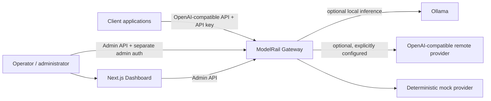
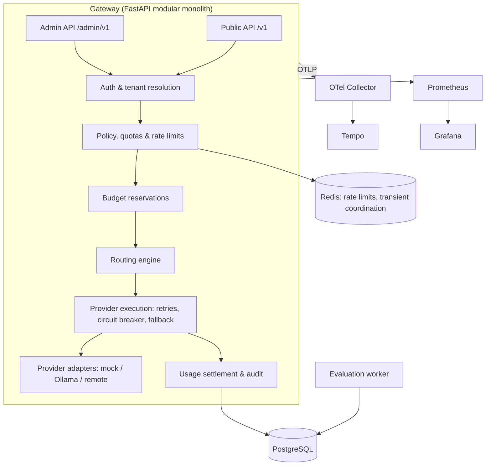
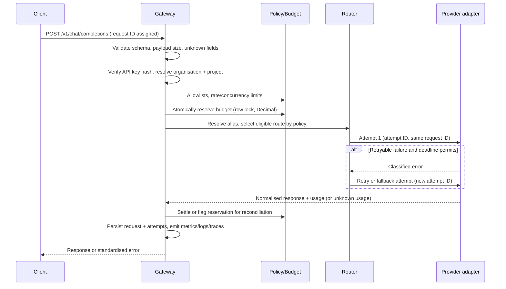
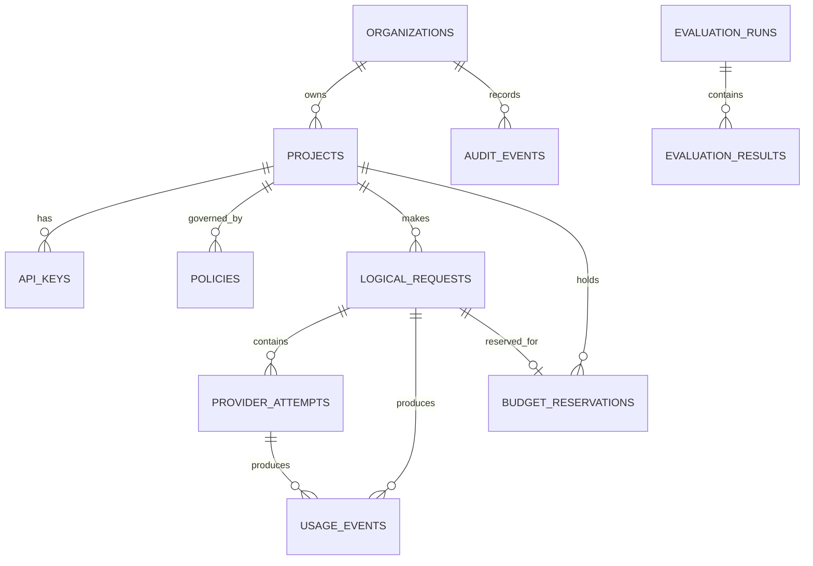
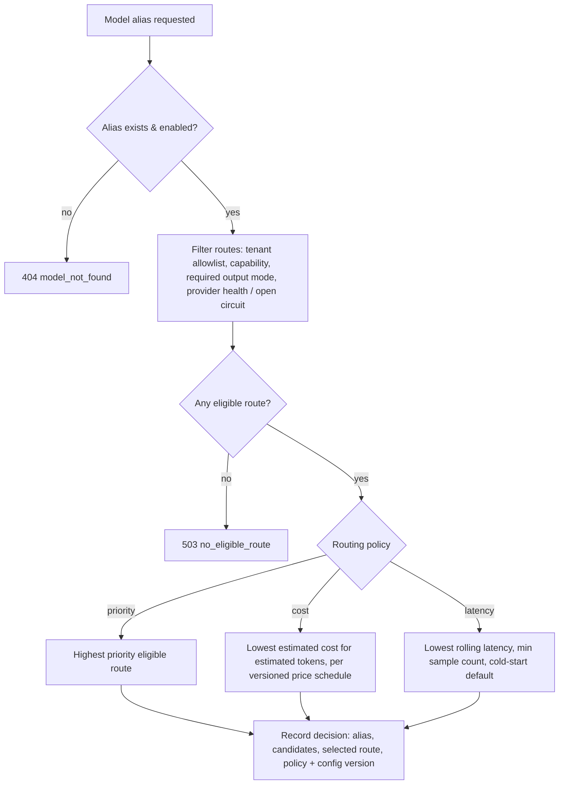
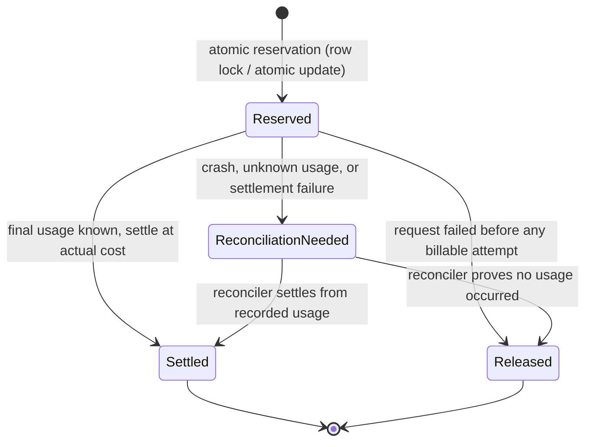

# ModelRail Architecture Overview

ModelRail is a self-hostable, OpenAI-compatible LLM gateway implemented as a
**modular monolith with separate worker processes** (spec §3, ADR-0001).
PostgreSQL is the authoritative store; Redis holds only transient
coordination state (ADR-0002).

## Context diagram

## Component diagram

Boundaries (spec §3.4): the domain layer never depends on FastAPI request
objects; provider adapters implement one shared interface; the router contains
no provider-specific HTTP code; policy enforcement is separate from model
selection; usage accounting is separate from response rendering.

## Request lifecycle

The request ID is constant across all attempts of one logical request; every
provider attempt has its own attempt ID (spec §3.3).

## Database relationships

Tables and fields are specified in spec §12: organisations, projects, API keys
(hash + prefix only, never plaintext), model routes, policies, logical
requests, provider attempts, usage events (unique `event_key`), budget
reservations, audit events, evaluation runs and evaluation results.

## Provider adapter contract

All adapters implement one typed contract (spec §7):

| Method | Responsibility |
|---|---|
| `capabilities()` | Provider identity, configured models, supported modes (streaming, max tokens) |
| `health_check()` | Availability without performing inference |
| `complete(request)` | Non-streaming inference, normalised response + usage |
| `stream(request)` | Streaming inference as normalised events, in order |
| `normalize_usage(response)` | Provider-reported usage preferred; explicit estimate/unknown otherwise |
| `classify_error(error)` | Map to retryable / non-retryable classes (timeout, rate-limit, auth, server, malformed) |
| `close()` | Release HTTP clients/connections safely |

Adapters: **mock** (deterministic, fault-injectable, sufficient for the full
test suite), **Ollama** (local, optional), **remote OpenAI-compatible**
(disabled unless explicitly configured; credentials from environment only;
upstream destinations validated — never taken from client requests).

## Routing decision process

Estimated cost is never presented as actual provider billing (spec §8.2).
Latency routing defines a measurement window, minimum samples, exclusion of
unhealthy routes and a configured fallback before history exists (§8.3).
Every decision is auditable without logging prompt content (§8.4).

## Budget reservation lifecycle

Rules (spec §10, ADR-0003): conservative reservation amount; hard-budget
rejection if the reservation would exceed the budget; never a check-then-write
sequence without concurrency protection; Decimal arithmetic with pricing
version stored; usage-event ingestion is idempotent via a unique event key, so
retries never double-count; uncertain usage is represented explicitly
(provider-reported / calculated / estimated / simulated / unknown), never
invented.
