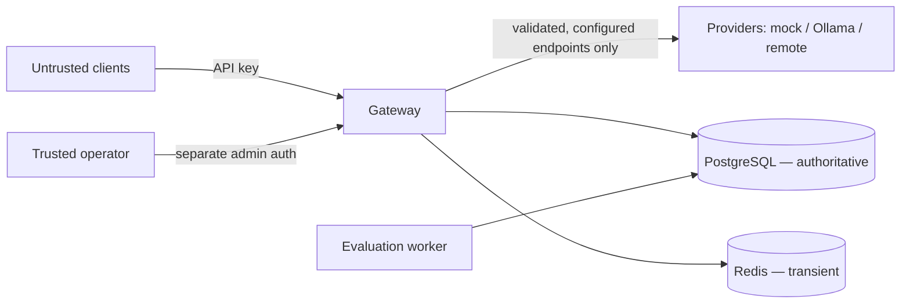

# ModelRail Threat Model

## Assets

- Gateway API keys (hashes + prefixes) and the key pepper.
- Administrative identities/tokens.
- Provider credentials (remote adapter) and Ollama endpoint configuration.
- Tenant data: projects, policies, requests metadata, usage and cost records,
  budget balances, audit events, evaluation datasets and reports.
- Prompt/completion content (transient; **not logged by default**).
- Availability of the gateway, PostgreSQL and Redis.

## Trust boundaries

Boundaries: (1) client → gateway, (2) operator → admin API (independent
auth), (3) gateway → provider (configured destinations only), (4) services →
data stores (network-local in Compose).

## Threats and mitigations

| Threat | Boundary | Mitigation |
|---|---|---|
| Stolen/leaked API key used by a third party | client→gateway | High-entropy keys, hash-only storage with pepper, prefix identification, expiry, prompt revocation, per-project rate/budget limits cap the blast radius, `last_used_at` aids detection |
| Cross-tenant access by changing a resource ID (IDOR) | client→gateway, operator→admin | Organisation/project scoping enforced at the service/authorisation boundary on every query; untrusted IDs are never proof of authorisation; horizontal-escalation tests (spec §17.4) |
| Admin compromise via an inference key | operator→admin | Administrative access is independently authenticated; an inference API key alone grants no admin capability; admin actions are audit-logged |
| Secret leakage in logs, errors or responses | all | Structured-log redaction; keys shown once at creation and never returned again; provider exceptions redacted; prompts/completions not logged by default (ADR-0008) |
| SSRF through provider configuration | gateway→provider | Upstream URLs come only from server configuration, never from client requests; destinations validated/restricted; unsafe redirects not followed (§16.4) |
| Resource exhaustion (oversized bodies, token floods, concurrency) | client→gateway | Body-size, input and max-output limits; request/token rate limits; concurrency caps; bounded retries and request deadlines; evaluation-worker concurrency limits (§11, §16.3) |
| Budget race / double-spend under concurrency | gateway→DB | Atomic reservation under row lock with Decimal arithmetic (ADR-0003); idempotent usage events with unique event keys; reconciliation job |
| Duplicate usage accounting on retries | gateway→DB | Logical request vs attempt separation; unique `event_key`; settlement idempotency, property-tested (§17.6) |
| Redis compromise/flush corrupting accounting | services→stores | Redis holds transient state only; PostgreSQL is authoritative (ADR-0002) |
| Malicious model output treated as trusted | provider→gateway→client | Output is untrusted input: structured outputs validated, generated code/commands never executed automatically (§16.5) |
| Prompt injection in evaluated or routed content | client→provider | Treated as risk reduction, not a guarantee: no automatic tool/command execution, sensitive-data disclosure checks in evaluations, limitations documented |

## AI-specific risks

- **Prompt injection:** cannot be fully prevented; ModelRail's defence is
  blast-radius control (no automatic execution, tenant isolation, budgets).
- **Sensitive-data disclosure by a model:** mitigated by not logging payloads
  by default and by disclosure checks in the evaluation set — automated
  checks are labelled as partial. **PII redaction of model output is NOT
  implemented in this release** (an earlier draft of this document claimed
  an "optional tested PII redaction"; that control does not exist in the
  code and is listed here as a known gap, not a mitigation).
- **Untrusted structured output:** always schema-validated before use.
- **Evaluation over-claiming:** benchmark/evaluation reports must record
  versions and environment and must not state unmeasured results (§13, §21).

## Residual risks

- A legitimately-issued key used within its limits by a malicious insider is
  bounded (budgets, audit) but not prevented.
- Local Compose deployment is a development topology: default placeholder
  passwords in `.env.example` must be replaced, ports are published to the
  host, and there is no TLS termination in the local stack.
- Provider-side behaviour (a remote provider logging prompts, changing a
  model) is outside ModelRail's control and is only normalised/detected, not
  governed.
- Latency/cost figures are valid only for the environment in which they were
  measured.
